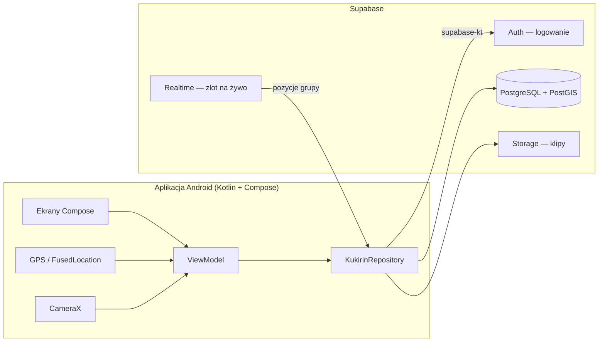
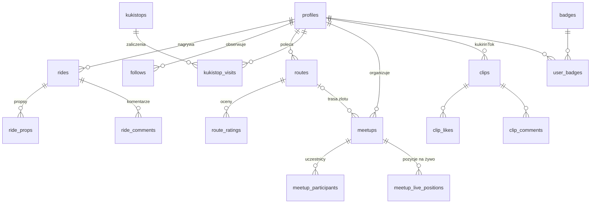

# Architektura

## Ogólnie

- **Ekrany** (Compose) tylko wyświetlają stan i przekazują kliknięcia.
- **ViewModel** trzyma stan ekranu i logikę (np. nagrywanie przejazdu).
- **KukirinRepository** to jedyne miejsce, które rozmawia z backendem. Teraz: `FakeKukirinRepository`, docelowo `SupabaseKukirinRepository`.
- **Supabase** daje gotowe logowanie, bazę, pliki i realtime — backend skupia się na schemacie, regułach dostępu (RLS) i funkcjach SQL.

## Model danych

## Ważne decyzje

| Decyzja | Dlaczego |
|---|---|
| Natywny Android (Kotlin + Compose) | Nikt nie ma Maca, a GPS w tle, kamera i mapy działają najpewniej natywnie. Kotlin i Compose to aktualny standard Google. |
| Supabase zamiast własnego serwera | Darmowy plan, gotowe logowanie, PostGIS do zapytań „co jest w pobliżu”, Realtime do mapy zlotu, Storage na filmiki. Mniej pracy przy serwerze, więcej przy funkcjach. |
| Rankingi bez prędkości | Nie zachęcamy do szybkiej jazdy — liczą się kilometry i regularność. |
| Zaliczanie kukistopów tylko przez funkcję w bazie | Serwer sprawdza odległość od punktu, więc nie da się „zaliczyć” go z kanapy przez zwykły zapis do tabeli. |

## Biblioteki do dodania w kolejnych sprintach

| Do czego | Biblioteka |
|---|---|
| Połączenie z Supabase | `io.github.jan-tennert.supabase` (supabase-kt) + Ktor client |
| Mapa (OpenStreetMap, bez klucza API) | `org.osmdroid:osmdroid-android` |
| GPS | `com.google.android.gms:play-services-location` |
| Nagrywanie klipów | CameraX (`androidx.camera:camera-video`) |
| Odtwarzanie klipów | Media3 ExoPlayer (`androidx.media3:media3-exoplayer`) |
| Obrazki z sieci | Coil (`io.coil-kt.coil3:coil-compose`) |

Aktualne wersje sprawdzajcie na stronach bibliotek i dopisujcie do `gradle/libs.versions.toml`.
